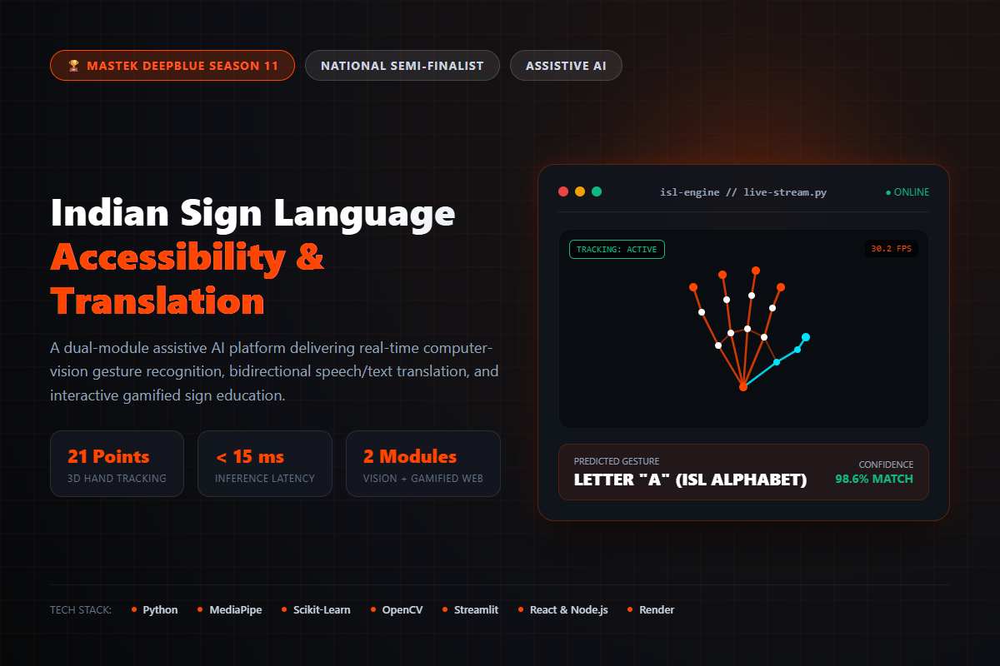
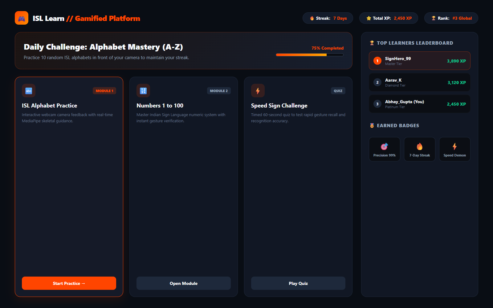

# ISL Mastek Asset Generation Prompts

Use this document to generate visual assets for the **ISL Accessibility and Translation System** portfolio project.

## Project Context

ISL Mastek is a two-module Indian Sign Language accessibility system:

1. Real-time sign alphabet and number recognition using computer vision.
2. Speech-to-Sign and Text-to-Sign translation using sign animations.
3. A gamified learning platform with practice exercises, quizzes, scores, and leaderboards.

The project uses Python, MediaPipe, Scikit-learn, OpenCV, Streamlit, PyTorch, React, Node.js, Express.js, and Render. It was a National Semi-Finalist project at Mastek DeepBlue Season 11.

Do not generate private credentials, API keys, fake certificates, fake user data, or claims that are not present in the project description.

## Visual Direction

- Dark developer-portfolio aesthetic.
- Black and deep charcoal background.
- Orange accent color matching the portfolio: `#FF4500`.
- White and light-gray typography.
- Accessible, inclusive, professional, and technology-focused.
- Use diverse, respectful representation of deaf and hard-of-hearing users.
- Avoid depicting sign language inaccurately or using random hand poses as real ISL signs.
- Do not place unreadable pseudo-text inside generated images.
- Prefer clean UI mockups, realistic interface layouts, and visually clear hand-landmark overlays.

## 1. Project Hero Image

**Suggested filename:** `assets/projects/isl-mastek-hero.png`

**Dimensions:** 1200 × 800 px

**Prompt:**

> Create a professional portfolio hero illustration for an Indian Sign Language accessibility and translation system. Show a modern computer-vision interface detecting a user's hand with a subtle MediaPipe-style landmark skeleton overlay, alongside a clean translation panel and accessible learning controls. Use a dark charcoal background, orange highlights, white interface elements, soft cyan secondary accents, rounded cards, subtle glassmorphism, and a polished machine-learning dashboard style. The mood should be inclusive, trustworthy, educational, and technically sophisticated. Do not use logos, brand names, readable paragraphs, random alphabet claims, or inaccurate sign-language labels. Leave clear negative space on the left for a webpage title. No watermark.

## 2. Translation Application Screenshot Mockup

**Suggested filename:** `assets/projects/isl-translation-interface.png`

**Dimensions:** 1600 × 1000 px

**Prompt:**

> Design a high-fidelity web application mockup for an Indian Sign Language real-time translation tool. Include a large camera preview area with a hand detection bounding box and abstract landmark points, a result panel for recognized sign output, confidence visualization, and controls for alphabet and number recognition. Use dark mode, orange primary actions, accessible contrast, large readable controls, and a clean Streamlit-inspired layout. Keep all text short and generic, such as "Live Recognition", "Detected Sign", and "Confidence". Do not show private information, real faces, fake accuracy numbers, or inaccurate sign-language labels. No logos or watermark.

## 3. Gamified Learning Platform Mockup

**Suggested filename:** `assets/projects/isl-learning-interface.png`

**Dimensions:** 1600 × 1000 px

**Prompt:**

> Create a polished dark-mode web interface for an Indian Sign Language learning platform. Show a lesson card, sign-practice exercise, quiz progress indicator, score summary, achievement badges, and a leaderboard layout. Use a friendly but professional education-product style with orange accents, accessible typography, rounded cards, and clear visual hierarchy. Use generic placeholder labels such as "Practice", "Quiz Progress", "Your Score", and "Leaderboard". Do not generate real personal names, fake rankings, inaccurate sign-language diagrams, or branded logos. No watermark.

## 4. Computer Vision Pipeline Diagram

**Suggested filename:** `assets/projects/isl-pipeline.png`

**Dimensions:** 1400 × 800 px

**Prompt:**

> Create a clean technical architecture diagram for an Indian Sign Language recognition pipeline. Show the flow: camera input, hand landmark detection, feature extraction, machine-learning classifier, recognized sign, and translation output. Use simple connected blocks, dark background, white labels, orange arrows, and subtle cyan technical accents. The diagram must be easy to understand in a software portfolio. Use only these exact short labels: "Camera Input", "Hand Landmarks", "Feature Extraction", "ML Classifier", "Recognized Sign", and "Translation Output". No extra text, no logos, no watermark.

## 5. Speech-to-Sign and Text-to-Sign Illustration

**Suggested filename:** `assets/projects/isl-bidirectional-translation.png`

**Dimensions:** 1400 × 800 px

**Prompt:**

> Create a professional conceptual illustration showing bidirectional accessibility translation. On the left, show spoken English and typed text entering a translation system. In the center, show an AI translation layer with neutral accessibility symbols. On the right, show sign-language animation frames represented by clean abstract hand-motion silhouettes. Use a dark background, orange directional arrows, white labels, and a modern AI product visual style. Use only short labels: "Speech", "Text", "Translation", and "ISL Signs". Do not depict inaccurate real signs, do not use copyrighted characters, and do not include fake performance metrics. No watermark.

## 6. Social Preview / Open Graph Image

**Suggested filename:** `assets/projects/isl-mastek-og.png`

**Dimensions:** 1200 × 630 px

**Prompt:**

> Create a social media preview image for a software engineering portfolio project titled "ISL Accessibility and Translation System". Show a subtle hand-landmark computer-vision graphic, a translation interface card, and a gamified learning card on a dark charcoal background with orange accents. Reserve a large readable area for the exact title "ISL Accessibility and Translation System" and a smaller subtitle "Computer Vision · Machine Learning · Inclusive Design". Use clean high-contrast typography, no extra paragraphs, no fake statistics, no logos, and no watermark.

## 7. Project Icon

**Suggested filename:** `assets/projects/isl-mastek-icon.png`

**Dimensions:** 512 × 512 px

**Prompt:**

> Create a minimal square icon for an Indian Sign Language accessibility technology project. Use a simplified respectful hand-and-signal symbol combined with a small computer-vision landmark motif. Use orange and white on a deep charcoal circular background. Flat vector style, strong silhouette, high contrast, recognizable at 64 pixels, no text, no logo, no watermark, transparent or clean dark background.

## Asset Quality Checklist

Before adding a generated asset to the website:

- Confirm the image contains no API keys, credentials, private data, or personal information.
- Confirm any sign-language depiction has been reviewed by a knowledgeable person or replaced with an abstract visual.
- Confirm text is spelled correctly and remains readable.
- Export PNG or WebP with reasonable compression.
- Add meaningful alternative text in HTML.
- Provide explicit `width` and `height` attributes to reduce layout shift.
- Use `loading="lazy"` for below-the-fold images.
- Use `loading="eager"` only for the primary hero image.
- Check mobile cropping before publishing.
- Do not claim that generated visuals are screenshots of the actual application unless they are recreated from the real interface.

## Recommended HTML Pattern

```html

```

For below-the-fold assets:

```html

```
